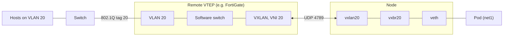

# vxlan-cni

A CNI plugin that attaches a pod to a VLAN over VXLAN. The pod names the VLAN in its manifest, and the plugin creates the VTEP for that VLAN on the node on demand. Nodes need no tagged VLAN interfaces and no trunk port: VXLAN runs over the node's normal address.

It is meant to be used as a secondary network with [Multus](https://github.com/k8snetworkplumbingwg/multus-cni). A single NetworkAttachmentDefinition covers every VLAN.

```yaml
metadata:
  annotations:
    k8s.v1.cni.cncf.io/networks: |
      [{ "name": "vxlan", "namespace": "kube-public", "cni-args": { "vlan": 20 } }]
```

## How it works



On ADD the plugin:

1. Reads the VLAN ID from the pod and rejects it unless it is in `allowedVlans`.
2. Creates `vxlan<ID>` (VNI = VLAN ID, default remote = `remote`) and the bridge `vxbr<ID>` if they do not exist yet, and adds an FDB entry for each of `peers`.
3. Creates a veth pair, attaches the host end to `vxbr<ID>`, and runs the IPAM plugin for the pod end.

On DEL it removes the pod interface, releases the address, and deletes `vxbr<ID>` and `vxlan<ID>` when no pod on the node uses them any more. VTEP changes are serialized with a lock file (`/run/vxlan-cni.lock`).

The VTEP is the Linux kernel's VXLAN device; the plugin only manages it. The remote VTEP must bridge the VXLAN segment with the VLAN, and it must do so for every VLAN in `allowedVlans`.

## Configuration

| Key | Default | Description |
|---|---|---|
| `remote` | Required | IPv4 address of the remote VTEP. Unknown unicast, broadcast and multicast frames are sent there. |
| `allowedVlans` | Required | VLAN IDs pods may request. Numbers or ranges, e.g. `[10, 20, "42-45"]`. Everything else is rejected. |
| `local` | Source address of the route to `remote` | Source address of VXLAN packets. |
| `port` | `4789` | VXLAN UDP port. |
| `mtu` | Underlay MTU minus 50 | MTU of the VXLAN device, the bridge and the pod interface. |
| `peers` | None | Other nodes that also receive flooded frames, so pods on different nodes reach each other directly. The node's own address may be listed; it is skipped. |
| `vlan` | None | VLAN used when the pod does not request one. |
| `keepDefaultRoute` | `false` | Keep a default route returned by IPAM. By default it is dropped, because the pod's primary network owns the default route. |
| `ipam` | None | Any IPAM plugin. Without it the pod interface has no address. |

The VLAN is read from, in order of priority: `args.cni.vlan` (Multus `cni-args`), `VLAN=` in `CNI_ARGS`, then `vlan`.

## Example

NetworkAttachmentDefinition shared by all VLANs. The `dhcp` IPAM plugin gets the address from the VLAN's DHCP server, so the NAD does not need a subnet per VLAN.

```yaml
apiVersion: k8s.cni.cncf.io/v1
kind: NetworkAttachmentDefinition
metadata:
  name: vxlan
  namespace: kube-public
spec:
  config: |
    {
      "cniVersion": "1.0.0",
      "name": "vxlan",
      "type": "vxlan",
      "remote": "192.0.2.1",
      "peers": ["192.0.2.10", "192.0.2.11", "192.0.2.12"],
      "allowedVlans": [10, 20, 30, 40, "42-45"],
      "ipam": { "type": "dhcp" }
    }
```

On a VLAN without DHCP, use a separate NAD with the `static` IPAM plugin and pass the address with Multus `ips`:

```yaml
k8s.v1.cni.cncf.io/networks: |
  [{ "name": "vxlan-static", "namespace": "kube-public", "cni-args": { "vlan": 30 }, "ips": ["192.0.2.50/24"] }]
```

Remote VTEP on FortiOS 6.2 (one VXLAN interface and one software switch per VLAN; move the VLAN's IP address, DHCP server and policies to the software switch):

```
config system vxlan
    edit "vxlan20"
        set interface "dmz"
        set vni 20
        set remote-ip "192.0.2.10" "192.0.2.11" "192.0.2.12"
    next
end
config system switch-interface
    edit "sw-vlan20"
        set member "VLAN20" "vxlan20"
        set intra-switch-policy implicit
    next
end
```

## Installation

1. Download `vxlan-linux-<arch>` from the [releases](https://github.com/TechnoTUT/vxlan-cni/releases) (checksums in `SHA256SUMS`), or build it, and install it as `vxlan` in the CNI binary directory (usually `/opt/cni/bin/vxlan`) on every node.
2. When using `"ipam": {"type": "dhcp"}`, run the DHCP daemon on every node (`/opt/cni/bin/dhcp daemon`, e.g. as a systemd unit).
3. Allow UDP 4789 between the nodes and the remote VTEP.

## Notes

- `allowedVlans` is the only thing that keeps pods out of other VLANs, such as management networks. Anyone who can create a pod that references the NAD can join any allowed VLAN. Create VXLAN interfaces on the remote VTEP only for VLANs you allow.
- The default MTU (underlay MTU minus 50) is smaller than that of hosts on the VLAN. TCP adapts through MSS, but large UDP packets from those hosts are fragmented or dropped. Raise the underlay MTU if you need 1500 inside.
- The bridge and the VXLAN device have no address and IPv6 is disabled on them, so the node itself does not join the VLAN.
- An existing `vxlan<ID>` with a different VNI, remote or port is reported as an error instead of being replaced. Delete it once no pod uses it.
- Without `peers`, traffic between pods on different nodes depends on the remote VTEP forwarding between its VXLAN remotes. FortiOS does not (see [test/fortigate](test/fortigate)), so set `peers` when pods on different nodes must talk to each other.

## Development

```
go test ./...
go build -o vxlan .
```

Pushing a `v*` tag builds the binaries and creates a GitHub release.

[test/fortigate](test/fortigate) runs the plugin against a FortiGate VM.
