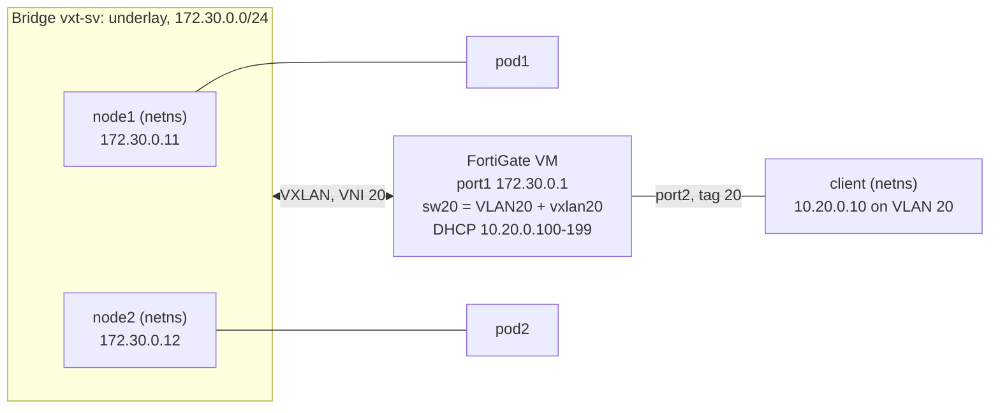

# FortiGate VM test

Runs the plugin against a FortiGate (or FortiFirewall) VM acting as the remote VTEP. Nodes, pods and a host on the tagged VLAN are network namespaces on this machine, so Kubernetes and Multus are not involved.



## Requirements

- KVM, libvirt, `virt-install`, `xorriso`, Go, root (`sudo`). About 2.5 GB of free memory.
- A FortiGate-VM or FortiFirewall-VM image for KVM (`fortios.qcow2`, or the `*_VM64_KVM-*.zip` from the Fortinet support portal).

## Usage

```
sudo ./up.sh /path/to/FGT_VM64_KVM-....zip   # FGT_WAN=1 adds port3 with Internet access (FortiCare)
sudo ./test.sh
sudo ./down.sh                                # --all also removes .state/ (admin password)
```

`up.sh` builds the plugin and the `dhcp` IPAM plugin, creates the bridges and namespaces, starts one DHCP daemon per node, and boots the VM with a day0 config drive ([`fgt-day0.conf.in`](fgt-day0.conf.in)). The admin password is in `.state/admin-password`; FortiOS may ask to change it on the first interactive login.

## What is checked

| Check | Expected |
|---|---|
| ADD on two nodes with `dhcp` IPAM | Address from the FortiGate DHCP server, no default route in the pod |
| Pod to the VLAN host and to the FortiGate | ping works |
| Broadcast and multicast between the VLAN host and pods | Delivered in both directions |
| Pod to pod on another node, without `peers` | Reported (INFO) |
| 1400-byte and 1500-byte packets from the VLAN host | 1400 works; 1500 reported (INFO) |
| DEL | VTEP removed from both nodes |
| ADD with `peers`, then pod to pod | ping, broadcast and multicast work |

## Results

FortiFirewall-VM64-KVM v7.6.8 build 3744, license status Invalid (evaluation), 1 vCPU, 2 GB: 32 PASS, 0 FAIL.

- A VLAN interface and a VXLAN interface can be members of one software switch.
- The DHCP server on the software switch answers pods once `vci-match` is disabled (it was enabled by default).
- The FortiGate does **not** forward frames between its VXLAN remotes. Set `peers` when pods on different nodes must reach each other.
- A 1500-byte packet from the VLAN reaches a pod with MTU 1450; the FortiGate fragments the outer packet.

### FortiGate 100D, FortiOS 6.2.16

The same setup was checked once on the production FortiGate with a temporary VLAN 21 (`po1`), `vxlan21` on `dmz` and a software switch with a DHCP server, using two Kubernetes nodes with a network namespace as the pod. The configuration was removed afterwards.

- FortiOS 6.2.16 accepts a VLAN interface and a VXLAN interface in one software switch. The DHCP server has no `vci-match` setting to change.
- Pods got addresses from the FortiGate, had no default route, and reached the FortiGate with 1450-byte packets (DF set).
- Pod to pod across nodes failed without `peers` and worked with them (ping, broadcast, multicast). FortiOS 6.2 does not forward between VXLAN remotes either.
- With the `connected` routes redistributed into BGP, the software switch subnet is advertised as soon as it has an address.
- In the test, the pods on both nodes used the same container ID and got the same DHCP address, because the `dhcp` IPAM plugin derives the client ID from it. Kubernetes container IDs are unique, so this does not happen there.

Throughput and CPU load were not measured; there was no host on VLAN 21 to send traffic through the FortiGate.
